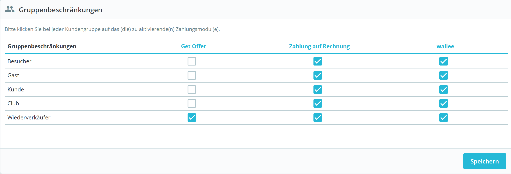

<!--
User documentation for the Internauten B2B Offer PrestaShop module.
Copyright (c) 2026 die.internauten.ch GmbH
License: MIT
-->

# Internauten B2B Offer

Payment module that adds a "Get Offer" payment method. Customers place the order and it is set to a pending "Awaiting Get Offer" state so you can review and respond with a custom offer.

## Features

- Adds a checkout payment method: Get Offer.
- Creates a pending order in "Awaiting Get Offer" state.
- Adds two extra order states for your workflow: "Offer accepted" and "Offer rejected".
- Custom order confirmation message for this payment method.
- Replaces the standard order confirmation email (`order_conf`) with an "Offer request" email for orders placed with this payment method.
- Sends custom emails for "Offer accepted" and "Offer rejected" with full order details.
- Lets customers place an accepted offer as a new order with one click from their order details page.
- Back office settings for the email template source and debug logging.
- Back office email preview: render any module email with the data of an existing order without sending it.

## Installation

1. Download zip of latest release.
2. In the back office: Modules -> Module Manager -> Load module.
3. Go to module settings.
4. In Payment -> Preferences, set the group restrictions to the customer groups that can request offers, and check the currency restrictions.
   

The "Get Offer" payment option is only shown for currencies enabled for this module in Payment -> Preferences.

## Usage

1. Customer selects "Get Offer" at checkout and completes the order.
2. The order is created with status "Awaiting Get Offer" and the customer receives the "Offer request" email.
3. You review the order and switch it to "Offer accepted" or "Offer rejected" in the order status dropdown. The customer receives the matching email.
4. For accepted offers, see [Place accepted offer](#place-accepted-offer).

Note: Uninstalling the module keeps the custom order states so historical orders remain readable.

## Place accepted offer

When an order has the status "Offer accepted", the logged-in customer sees a "Place accepted offer now" button on the order details page in their account.

Clicking the button:

1. Verifies that the order belongs to the customer, was placed with this module, matches the order's secure key, and is still in "Offer accepted" state.
2. Duplicates the original cart (same flow as the PrestaShop reorder function). If duplication fails, the cart is rebuilt from the order lines.
3. Redirects the customer to checkout with the new cart, where the order can be completed with a regular payment method.

If the cart cannot be transferred, the order details page shows a warning asking the customer to contact support.

## Configuration

Back Office: Modules -> Module Manager -> Get Offer -> Configure.

| Setting | Configuration key | Default | Description |
|---|---|---|---|
| Use module email templates | `INTERNAUTENB2BOFFER_MODULE_MAIL_TPL` | Module | Controls where the `offer_request` template is loaded from. See [Email templates](#email-templates). |
| Enable debug logs | `INTERNAUTENB2BOFFER_DEBUG_LOGS` | Disabled | Writes module debug traces to the back office logs. |

### Email preview

The "Email preview" panel on the configuration page renders an email with the data of an existing order. No email is sent.

| Field | Description |
|---|---|
| Order | One of the latest 100 orders placed with this module. |
| Template | `offer_request`, `offer_accepted`, or `offer_rejected`. |
| Format | HTML or text version of the template. |
| Language | Language used for the template and the order data. Defaults to the language of the order. |

The template is resolved like a real email (theme overrides first, then the module, with language fallback to the shop default and English). The resolved file path is shown above the preview. The HTML preview is displayed in a sandboxed iframe; the shop logo is loaded by URL instead of being embedded.

## Hooks

The module registers the following hooks on installation:

| Hook | Purpose |
|---|---|
| `paymentOptions` | Adds the "Get Offer" payment option at checkout (only for allowed currencies). |
| `paymentReturn` | Shows the custom confirmation message on the order confirmation page. |
| `displayOrderDetail` | Shows the "Place accepted offer now" button on the customer's order details page for orders in "Offer accepted" state. |
| `actionEmailSendBefore` | Replaces the `order_conf` email with `offer_request` for orders placed with this module. |
| `actionOrderStatusPostUpdate` | Sends the `offer_accepted` or `offer_rejected` email when the order status changes accordingly. |

`displayOrderDetail` was added in version 1.0.7 and is registered for existing installations by `upgrade/upgrade-1.0.7.php`.

`actionEmailSendBefore` must run before mail transport modules (e.g. `internautengraph`) that send the email within this hook and stop the core flow. Otherwise the customer receives the standard "Order confirmation" instead of the "Offer request". The module therefore moves itself to the first position of this hook on installation and when upgrading to 1.0.8. If you reorder the hook in Design -> Positions, keep this module first.

If you transplant or unhook any of these hooks in Design -> Positions, the related feature stops working.

## Debug logging toggle

The module contains debug logs guarded by configuration key `INTERNAUTENB2BOFFER_DEBUG_LOGS`.

Back Office toggle: Modules -> Module Manager -> Get Offer -> Configure -> Enable debug logs.

Or direct in DB:
- Enable logging:
   ```sql
   UPDATE ps_configuration SET value = '1' WHERE name = 'INTERNAUTENB2BOFFER_DEBUG_LOGS';
   ```
- Disable logging:
   ```sql
   UPDATE ps_configuration SET value = '0' WHERE name = 'INTERNAUTENB2BOFFER_DEBUG_LOGS';
   ```
- If missing (older install), create it once:
   ```sql
   INSERT INTO ps_configuration (name, value, date_add, date_upd)
   VALUES ('INTERNAUTENB2BOFFER_DEBUG_LOGS', '1', NOW(), NOW())
   ON DUPLICATE KEY UPDATE value = '1', date_upd = NOW();
   ```

All log entries are prefixed with `[internautenb2boffer]` and can be viewed in Back Office -> Advanced Parameters -> Logs.

## Email templates

This module ships the following email templates in the module folder:

- `mails/en/offer_request.html`
- `mails/en/offer_request.txt`
- `mails/en/offer_accepted.html`
- `mails/en/offer_accepted.txt`
- `mails/en/offer_rejected.html`
- `mails/en/offer_rejected.txt`
- `mails/de/offer_request.html`
- `mails/de/offer_request.txt`
- `mails/de/offer_accepted.html`
- `mails/de/offer_accepted.txt`
- `mails/de/offer_rejected.html`
- `mails/de/offer_rejected.txt`
- `mails/fr/offer_request.html`
- `mails/fr/offer_request.txt`
- `mails/fr/offer_accepted.html`
- `mails/fr/offer_accepted.txt`
- `mails/fr/offer_rejected.html`
- `mails/fr/offer_rejected.txt`
- `mails/it/offer_request.html`
- `mails/it/offer_request.txt`
- `mails/it/offer_accepted.html`
- `mails/it/offer_accepted.txt`
- `mails/it/offer_rejected.html`
- `mails/it/offer_rejected.txt`

| Email | Sent when | Template source |
|---|---|---|
| `offer_request` | Order is placed with "Get Offer" (replaces `order_conf`) | Depends on "Use module email templates" |
| `offer_accepted` | Order status changes to "Offer accepted" | Always the module path |
| `offer_rejected` | Order status changes to "Offer rejected" | Always the module path |

The HTML templates are plain, hand-written table layouts with inline styles (no MJML output, no external images or fonts). All languages share the same structure, so a change in one template can be copied to the others by only translating the texts.

### Theme overrides

For templates loaded from the module path, PrestaShop first looks in the active theme (and its parent theme), so you can override them without changing the module:

- `themes/<active_theme>/modules/internautenb2boffer/mails/<lang>/offer_request.html`
- `themes/<active_theme>/modules/internautenb2boffer/mails/<lang>/offer_request.txt`
- `themes/<active_theme>/modules/internautenb2boffer/mails/<lang>/offer_accepted.html`
- `themes/<active_theme>/modules/internautenb2boffer/mails/<lang>/offer_accepted.txt`
- `themes/<active_theme>/modules/internautenb2boffer/mails/<lang>/offer_rejected.html`
- `themes/<active_theme>/modules/internautenb2boffer/mails/<lang>/offer_rejected.txt`

If "Use module email templates" is set to "Theme / Default", `offer_request` is resolved like a core email instead: first `themes/<active_theme>/mails/<lang>/`, then the shop's `mails/<lang>/` folder, and finally the module's `mails/` folder as fallback. The following paths apply in that case:

- `themes/<active_theme>/mails/<lang>/offer_request.html`
- `themes/<active_theme>/mails/<lang>/offer_request.txt`

## Template variables

You can use the following placeholders in `offer_request`, `offer_accepted`, and `offer_rejected` templates:

**Common (HTML and TXT)**

- `{firstname}`
- `{lastname}`
- `{shop_name}`
- `{shop_url}`
- `{order_name}`
- `{date}`
- `{payment}`
- `{carrier}`
- `{total_paid}`
- `{history_url}`
- `{total_products}`
- `{total_discounts}`
- `{total_wrapping}`
- `{total_shipping}`
- `{total_tax_paid}`

**HTML-only**

- `{products}`
- `{discounts}`
- `{delivery_block_html}`
- `{invoice_block_html}`

**TXT-only**

- `{products_txt}`
- `{discounts_txt}`
- `{delivery_block_txt}`
- `{invoice_block_txt}`
